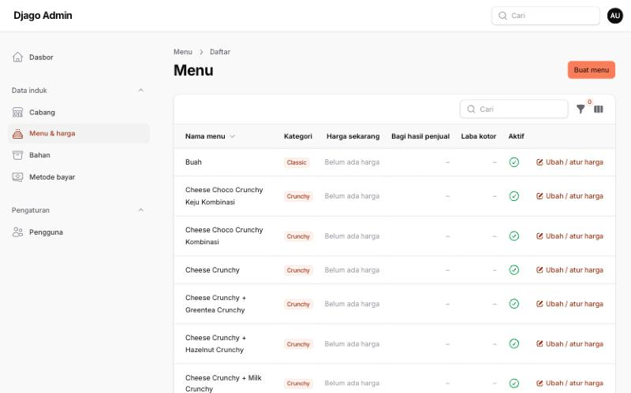
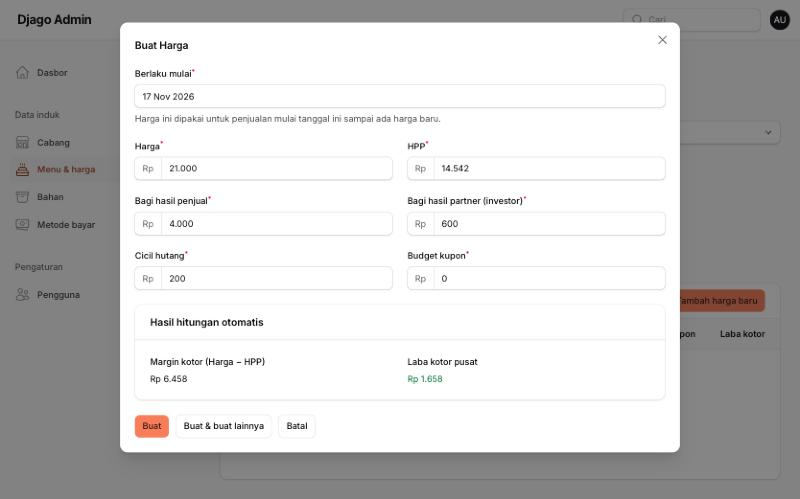
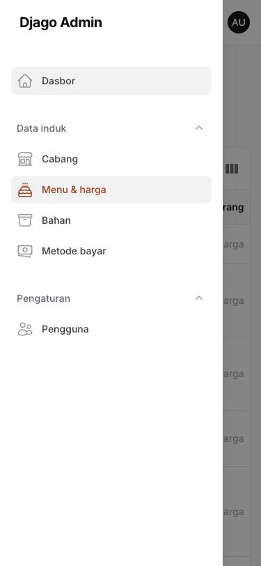
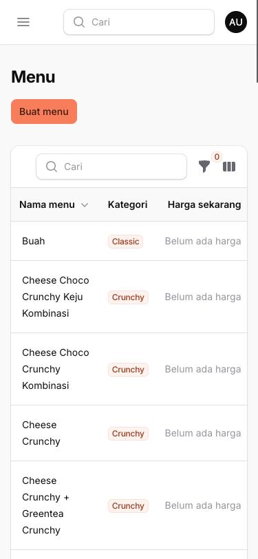
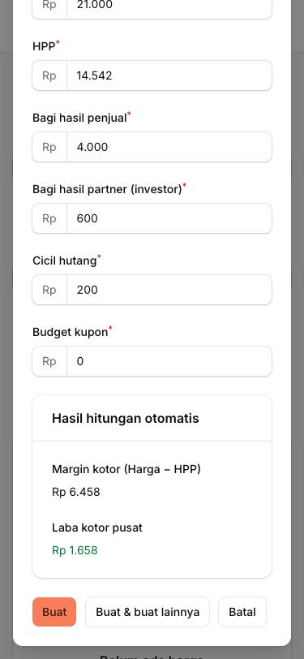

# Djago

Platform internal Roti Bakar Djago: laporan penjualan mitra, order bahan, setoran, dan bagi hasil.

- Rancangan Tahap 1: [docs/rancangan-tahap-1.md](docs/rancangan-tahap-1.md)
- Panel admin (lokal): http://localhost:8000/admin

## Tampilan

Tangkapan layar panel admin (langkah 1a, 17 Nov 2026). Angka di formulir harga adalah contoh
"Keju" dari Google Sheets lama, untuk menunjukkan hitungan otomatis; harga resmi belum diisi.

### Desktop (laptop)

**Daftar menu & harga**



**Formulir harga dengan hitungan otomatis** (Margin Kotor = Harga − HPP; Laba Kotor = Margin − semua bagi hasil)



### Mobile (HP)

<table>
  <tr>
    <td align="center"><b>Menu navigasi</b></td>
    <td align="center"><b>Daftar menu</b></td>
    <td align="center"><b>Formulir harga</b></td>
  </tr>
  <tr>
    <td></td>
    <td></td>
    <td></td>
  </tr>
</table>

Layar khusus mitra (login PIN, lapor penjualan, order bahan) dibuat di langkah 1b
mengikuti desain di [docs/referensi/](docs/referensi/).

## Status

| Langkah | Isi | Status |
|---|---|---|
| 1a | Fondasi: login admin, data induk (cabang, menu & harga, bahan, metode bayar, pengguna) | Selesai di Mac lokal |
| 1b | Layar mitra: login PIN, lapor penjualan, order bahan | Belum |
| 1c | Dashboard admin: ringkasan, laporan, antrian order, koreksi | Belum |
| 1d | Keuangan & investor: serah terima, bagi hasil, cicilan, rekap bulanan | Belum |
| 1e | Online & uji coba satu cabang | Belum |

## Menjalankan di Mac

```sh
export PATH="$HOME/.config/herd-lite/bin:$PATH" PHP_INI_SCAN_DIR="$HOME/.config/herd-lite/bin"
php artisan serve
```

Lalu buka http://localhost:8000/admin. Email dan kata sandi admin uji ada di file `.env`
(baris `DEV_ADMIN_EMAIL` dan `DEV_ADMIN_PASSWORD`). File itu tidak ikut ke GitHub.
